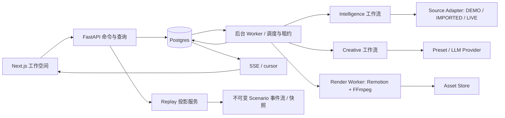

> 2026-11-04 范围更新：当前实施以 [Fully Mocked POC](POC_SCOPE.md) 为准。下文旧业务流程/后端/实时服务要求为历史，不能用于派发；当前数据/API/事件/状态机及验收见新POC文档。设计原则仍有效，具体四步布局见 pages/POC_WORKFLOW.md。本次未重做或撤销历史验收。

> 当前生效范围为[前端 Demo](FRONTEND_DEMO_SCOPE.md)。下文涉及后端、数据库、API与服务端任务的内容保留作未来参考，不是本期实施或验收条件。

# 总体架构决策

状态：主控设计基线 v0.1，待TASK-002契约实现核对；不是现有部署事实。

## 技术选择

| 层 | 选择 | 取舍 |
|---|---|---|
| Web | Next.js App Router + React + TypeScript | 独立专业工作空间；不在Next重复实现业务后端 |
| 样式 | CSS变量为权威，Tailwind仅消费Token；Radix/shadcn基础交互重塑外观 | 不继承默认SaaS主题；不强引入动画库 |
| 状态 | TanStack Query存服务状态；Zustand仅草稿/界面/演示本地控制 | 不在组件里独立算评分或反馈 |
| 图表 | Recharts适配共享主题、键盘与数据表替代 | 简单交互先满足可读性；不自造复杂图表引擎 |
| API | Python FastAPI / Pydantic | OpenAPI契约先行，统一校验与错误 |
| 存储 | PostgreSQL + 本地volume资产存储适配器 | JSONB存版本载荷，关系键保证主链；未来对象存储可替换 |
| Worker | 独立Python进程，Postgres持久任务表+租约轮询 | 无Redis/Celery；SQL SKIP LOCKED领任务，关闭浏览器不受影响 |
| 调度 | 同一Worker的due-job调度，数据库保存next_run_at与唯一键 | 不在多个API进程各开APScheduler，避免重复Feed |
| 通知 | SSE + 游标补读 | 单向事件足够；无需WebSocket |
| AI | OpenAI-compatible provider协议+确定性preset provider | 可配置模型与结构化校验；不是大型自治Agent框架 |
| 视频 | Node Remotion renderer + FFmpeg/ffprobe，独立render-worker | 支持React模板与阿文排版；实际导出需M5 spike证明，不只web预览 |
| 部署 | Docker Compose: web/api/worker/render-worker/postgres | Worker与renderer分资源；演示单环境命名空间隔离 |

版本在TASK-001按相容性锁定并提交lockfile，不从相邻项目盲拷贝版本。当前仅规划，尚未安装此栈。

Feed：autonomous_demo运行写入该demoNamespace的DEMO信号与机会；不读取浏览器计时器。Replay：固定scenarioVersion的不可变事件+纯投影，快照与控制存session；只读业务模拟空间。Create Campaign才将选定机会/商品/证据快照通过事务复制到Campaign，记录originReplaySessionId与sourceOpportunityVersion。

边界：domain负责状态机与评分；services负责事务用例；adapters负责外部IO；API不散落业务算法；UI只呈现服务数据。Agent“事件”是可审查的动作摘要/输入输出引用，不要求展示模型隐藏思维。

隔离键demoNamespaceId由服务端会话确定，不能信任请求body覆盖。所有查询、唯一约束、重置和文件权限带命名空间；跨session回放状态独立。API身份仅支持本地演示会话，不宣称已具备企业权限系统；对外部署前M6加演示访问保护。

## 公共契约管理

`contracts/openapi.json` 为本次设计契约；TASK-002补成Pydantic实现并比对生成OpenAPI。TS类型由契约生成到packages/contracts，不手写第二套；枚举/ID/错误统一。任何破坏性变更要版本号、迁移、影响页面与主控审查，DeepSeek不能自行修改。

事务覆盖：Campaign幂等交接、版本序号分配、审批/排期绑定、发布唯一执行、Reset代际切换。异步投递使用Outbox，事件/业务变更同事务。模拟发布重试也不能重复累计MetricSnapshot。
