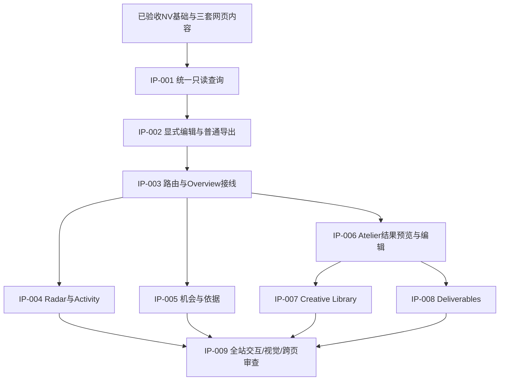

> 2026-11-05素材范围更新：用户已提供SERENITY Hero/白底原图/10.08秒MP4，并确认以SERENITY统一A案例、另补相符脚本。以docs/PRODUCT_RESCUE_ASSET_INTEGRATION.md和FAST_06为最新增量；本轮不制作视频，但允许真实提供素材预览/下载。冻结15秒核心Schema保持，Provided片走独立sidecar/API，不伪称匹配成片。

# 路由重构与交互产品里程碑

2026-11-05。旧NV工程验收保留；Interactive产品验收新开，尚未实现/测试/截图，不继承旧M1通过结论。

图示为主依赖；精确读/写依赖在task-plan.json和各任务中。可按依赖连续开发，图不表示每项都要停工等accepted。IP-003的六路由最终随真实页面一起验收，不交空占位导航。

| 里程碑 | 成果 | 验收重点 |
|---|---|---|
| IP-M0 规格 | 新信息架构/类型契约/页面/矩阵/9原子任务 | 本轮已准备；不是新UI完成 |
| IP-M1 通用能力 | IP-001/002 | 无会话可读预置、显式编辑、导出无邮件、无只读副作用 |
| IP-M2 A产品路径 | 路由接线+Radar/机会/Atelier预览 | 主控实际先看A首屏与推荐因果链、操作编辑，再复用B/C |
| IP-M3 六工作区 | Library/Deliverables及全导航 | 六路由冷启动、三场景关联、真实版本/导出、次级Activity/邮件 |
| IP-M4 产品验收 | IP-009 | 矩阵88模板展开实测、完整自由点击、1440/1366截图与理解评估 |

必要风险：旧Scenario gate误用于只读；预览误触发select/确认失效；全局导航丢脏稿；同Campaign多旧session归属不清；旧导出被新稿重建；从“技术表单”复制到六页。对应规则已在API/页面/矩阵冻结，不通过新增后端或随机占位解决。

视频/实时AI/外部平台/真实发送/生产部署仍在本批之外。未配置自动DSH入口；只提供可执行handoff，未自动派发。
