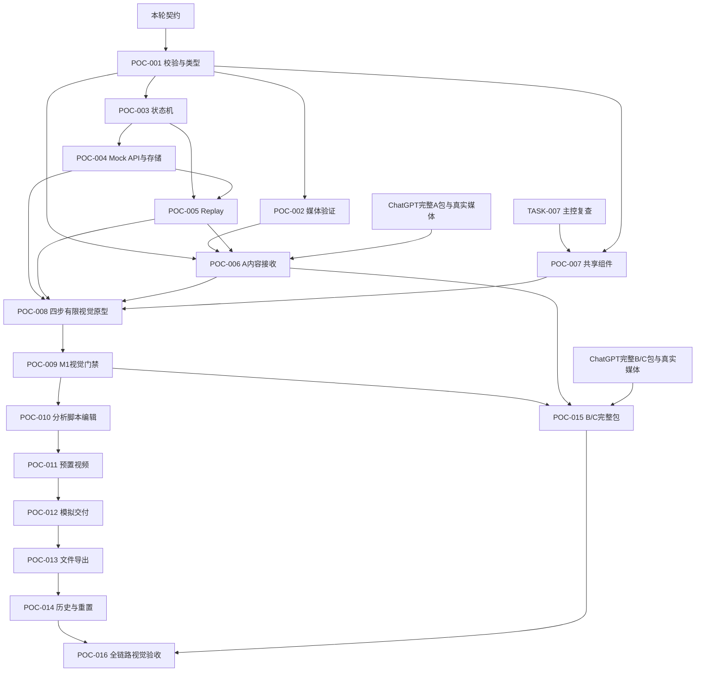

> 2026-11-05最高优先级更新：当前以 docs/INTERACTIVE_MOCK_PRODUCT.md、docs/INTERACTIVE_PRODUCT_API.md、docs/pages/INTERACTIVE_WORKSPACES.md 和 tasks/DSH_HANDOFF_DEMO_FAST_05.md 为准。六工作区可自由探索，Scenario只作数据容器；只读浏览无阶段前置。旧固定四步/唯一Home可用/导出依赖模拟邮件的要求不再用于开发。冻结场景Schema/业务JSON/Tokens不改，视频仍deferred。

> 2026-11-05范围更新：用户暂缓视频制作；当前以 docs/CONTENT_ONLY_DELIVERY.md 和 tasks/DSH_HANDOFF_DEMO_FAST_04.md 为准，视频缺失不阻塞非视频开发。旧完整视频要求保留作未来范围，不将文案Demo标为完整视频验收通过。

> 最新执行节奏：按docs/DEMO_DELIVERY_POLICY.md合并相关任务、聚焦前端与主链；已放行005+007同批实施，旧逐项停工要求不再适用。

# Fully Mocked POC 里程碑与任务依赖

原完整系统和旧前端业务拆分不再驱动开发；保留历史M0与M1门禁ID，新增POC任务避免覆盖旧记录。

| 阶段 | 成果 | 任务 | 放行 |
|---|---|---|---|
| P0 契约与数据基础 | 校验/类型、状态机、Mock API/持久化、Replay、A包 | POC-001–006 | 技术测试及A五层验证、主控内容审核 |
| M1 有限视觉原型 | 复核壳体、统一组件、A四步原型 | TASK-007复核、POC-007–009 | 实际浏览器截图/交互、修复、PO体验 |
| P1 A黄金路径 | 脚本编辑、视频、模拟交付、下载、历史 | POC-010–014 | 完整A链与恢复/重播/重置 |
| P2 三场景及验收 | B/C完整包、共用四步UI、最终测试 | POC-015–016 | 三场景完整链、0外部调用、主控与PO验收 |

001–005及007已accepted；当前放行008首页/四步框架，内容到齐后合并006接入。壳体可继续复用；只缺客户内容时不再阻止布局开发，也不能用测试数据填客户页面。

主要风险：内容/MP4不足→缺项锁入口；编辑与视频不匹配→保留派生稿并显式选预置版；存储失败→未保存提示与导出；回放污染→隔离和幂等；视觉退化→实际截图门禁；误接服务→外域请求检查。
